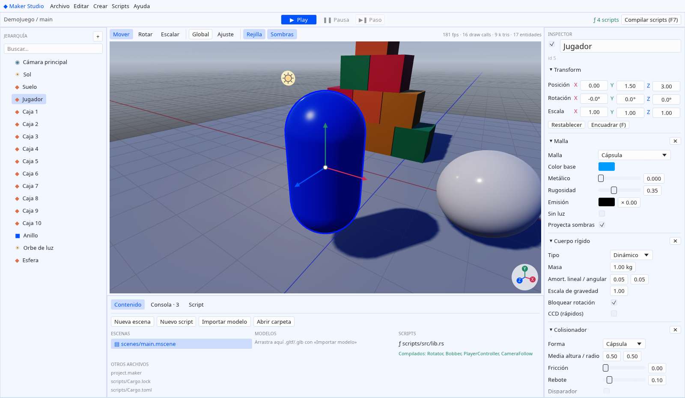
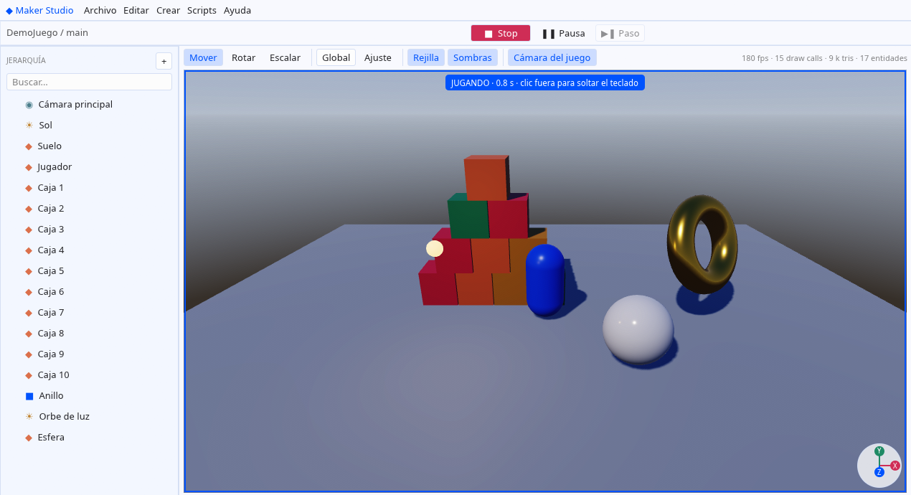
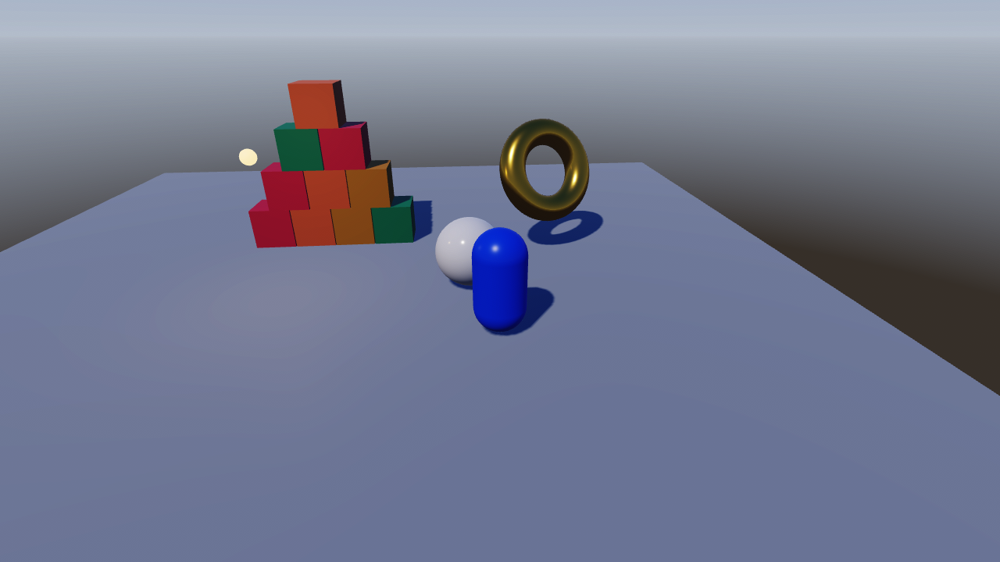

<p align="center">
  
</p>

# Maker Studio

Motor 3D con editor, hecho en **Rust** y con **scripting en Rust**. Toma las
buenas prácticas de Unity, Unreal y Godot (ECS por arquetipos, árbol de escena,
Play-en-editor con restauración, física a paso fijo, PBR, recarga en caliente
de código) en un motor pensado para rendir: todo es código nativo, también los
scripts de cada juego.



| | |
|---|---|
|  |  |
| **Play en el editor**: cámara del juego, scripts y física en vivo | **`maker-player`**: el juego exportado, sin editor |

## Qué tiene

- **Editor** (`maker-studio`): Project Hub, jerarquía con arrastrar y soltar,
  inspector de componentes, viewport 3D con gizmos de mover/rotar/escalar
  (local/global, ajuste a rejilla), selección por clic, cámara de vuelo estilo
  Unity/Unreal, explorador de contenido, consola, editor de scripts con
  resaltado, deshacer/rehacer, Play / Pausa / Paso con la escena restaurada al
  parar, ejecutar en ventana aparte y exportar el juego.
- **Motor** (`maker_engine`): ECS `hecs`, escenas `.mscene` en JSON legible,
  jerarquía padre/hijo, primitivas (cubo, esfera, plano, cilindro, cono,
  cápsula, toro) e importación **glTF/GLB**, física **Rapier** (cuerpos
  dinámicos, estáticos y cinemáticos; cajas, esferas, cápsulas, cilindros;
  raycast), entrada, bucle de juego con `fixed_update` a 60 Hz.
- **Render** (`maker_render`, wgpu → Vulkan/Metal/DX12/GL): PBR metal-rugosidad,
  sol con sombras PCF, 16 luces puntuales, cielo procedural, niebla, ACES,
  MSAA 4×, frustum culling, contorno de selección, rejilla infinita.
- **Scripting en Rust** (`maker_api`): cada proyecto tiene un crate `scripts/`
  que el editor compila (F7) y recarga en caliente; propiedades editables desde
  el Inspector; los pánicos se atrapan y salen en la consola. Ver
  [docs/SCRIPTING.md](docs/SCRIPTING.md).
- **Modo agente** (opcional, apagado por defecto): un panel para trabajar sobre
  el proyecto con Claude Code, Codex o Antigravity, con historial de sesiones,
  contexto del editor y recarga de escena y scripts tras cada turno. Ver
  [docs/AGENTE.md](docs/AGENTE.md).
- **Tema claro** de Hermes Agent Desktop (colores, radios y paleta de código
  extraídos de su CSS; tabla en `crates/maker_editor/src/theme.rs`).

## Instalación

Un solo comando compila el motor, el editor y el reproductor y los instala en
el sistema. Si falta algo (Rust 1.95+, un compilador de C y Git), pregunta
antes de instalarlo. Rust se queda instalado porque el editor lo usa para
compilar los scripts de cada proyecto.

**Linux y Mac:**

```bash
curl -fsSL https://raw.githubusercontent.com/evilrender23/Maker-Studio/main/instalar.sh | bash
```

**Windows** (PowerShell):

```powershell
irm https://raw.githubusercontent.com/evilrender23/Maker-Studio/main/instalar.ps1 | iex
```

También desde un clon: `bash Maker-Studio/instalar.sh` o
`powershell -ExecutionPolicy Bypass -File Maker-Studio\instalar.ps1`.

|  | Código y caché | Programas | Comandos | Acceso |
|---|---|---|---|---|
| Linux | `~/.local/share/MakerStudio/codigo` | `~/.local/share/MakerStudio/app` | enlaces en `~/.local/bin` | menú de aplicaciones |
| Mac | `~/Library/Application Support/MakerStudio/codigo` | `…/MakerStudio/app` | enlaces en `~/.local/bin` | `~/Applications/Maker Studio.app` |
| Windows | `%LOCALAPPDATA%\MakerStudio\codigo` | `%LOCALAPPDATA%\MakerStudio\app` | `app` en el PATH del usuario | menú Inicio |

Opciones: `--repo`, `--rama`, `--destino` y `--bin` (en Windows `-Repo`,
`-Rama` y `-Destino`). No borres la carpeta `codigo`: los scripts de tus
proyectos se compilan contra el `maker_api` que hay dentro.

### Actualizaciones automáticas

Una copia instalada se actualiza sola desde la rama `main` de GitHub, sin
releases: un minuto después de abrir el editor, y luego cada 6 horas, hace
`git fetch` en `codigo/`. Si hay commits nuevos, compila la versión nueva en
segundo plano, con una barra de progreso bajo el menú, y cuando está lista
ofrece **Reiniciar ahora**. Si cierras el editor sin reiniciar, la versión
nueva se aplica igualmente y es la que abre la próxima vez.

- **Ayuda → Buscar actualizaciones** comprueba en el momento.
- **Archivo → Preferencias → Actualizar automáticamente** activa o desactiva
  la búsqueda periódica.
- Desde la terminal: `maker-studio --actualizar` y `maker-studio --version`.
- Volver a ejecutar el comando de instalación también actualiza.

Las compilaciones hechas con `cargo build` (sin instalador) no se actualizan
solas.

## Compilar desde el código

Requisitos: Rust 1.95+ (edición 2024) y una GPU con Vulkan, Metal o DirectX 12
(OpenGL como último recurso).

```bash
cargo build --release
./target/release/maker-studio                 # Project Hub
./target/release/maker-studio ruta/al/proyecto
./target/release/maker-studio --new-demo ~/MakerProjects/Demo --build-scripts
./target/release/maker-player ruta/al/proyecto  # solo el juego
```

`maker-studio --help` lista las opciones para pruebas automáticas
(`--screenshot`, `--play`, `--hold TECLA`, `--select`, `--export`…).

En el Hub, **Crear proyecto** con la plantilla **Demo jugable** genera una
escena con un personaje físico (WASD, Espacio para saltar, F para lanzar
bolas), una pila de cajas, una luz que flota, un anillo que gira y una cámara
que sigue al jugador. Pulsa **F7** para compilar sus scripts y **▶ Play**.

### Controles del viewport

| Entrada | Acción |
|---|---|
| Clic derecho + WASDQE | volar (Shift rápido, rueda = velocidad) |
| Alt + clic izquierdo | orbitar |
| Botón central | desplazar |
| Rueda | acercar / alejar |
| W · E · R | mover · rotar · escalar |
| Ctrl al arrastrar un gizmo | ajuste (0,5 m · 15° · 0,1) |
| F | encuadrar la selección |
| F5 / Ctrl+P | Play / Stop |
| F7 | compilar y recargar scripts |
| Ctrl+S · Ctrl+Z · Ctrl+Y · Ctrl+D · Supr · F2 | guardar · deshacer · rehacer · duplicar · eliminar · renombrar |

## Un proyecto

```
MiJuego/
├── project.maker          nombre y escena principal
├── scenes/main.mscene     escenas (JSON)
├── assets/models/         .gltf / .glb
└── scripts/               crate de Rust → biblioteca dinámica
    ├── Cargo.toml
    └── src/lib.rs
```

**Archivo → Exportar juego** crea `export/<nombre>/` con el ejecutable, las
escenas, los assets y la biblioteca de scripts; ese ejecutable abre el juego
sin argumentos.

## Pruebas

```bash
cargo test --workspace --release
cargo test --release -p maker_engine --test hot_reload -- --ignored   # compila y recarga scripts reales
```

Más detalle en [docs/ARQUITECTURA.md](docs/ARQUITECTURA.md) (qué se toma de
cada motor y por qué) y [docs/ROADMAP.md](docs/ROADMAP.md).

Disclaimer: esto nace de un proyecto personal, para mi uso personal. Puedes
usarlo, pero no esperes que te dé soporte.

## Licencia

Maker Studio se distribuye bajo la [licencia MIT](LICENSE). Puedes usarlo,
modificarlo y redistribuirlo libremente (también en proyectos comerciales),
con una única condición: **debes atribuirme**. Cualquier copia o parte
sustancial del código debe conservar el aviso de copyright y el texto de la
licencia:

```
Copyright (c) 2026 EvilRender23
```

Si usas Maker Studio o parte de su código en tu proyecto, incluye un crédito
visible, por ejemplo: "Basado en Maker Studio de EvilRender23
(https://github.com/evilrender23)".
