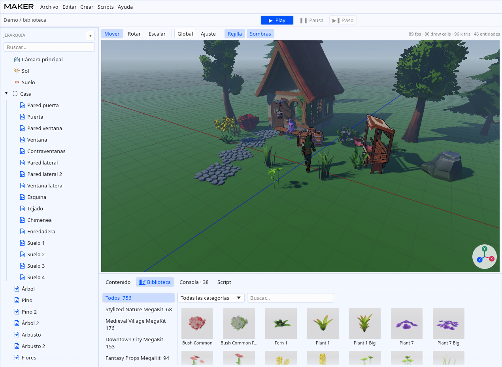

# Biblioteca integrada

Maker Studio trae una biblioteca de 756 modelos listos para usar: naturaleza,
un pueblo medieval, una ciudad, accesorios de fantasía, ciencia ficción,
personajes con esqueleto, atuendos y dos librerías de animaciones. Va con el
motor (`assets/biblioteca/`) y no se copia a cada proyecto. Al exportar un
juego solo se copian los archivos que usan sus escenas.



## Créditos y licencia

Todos los modelos son de **Quaternius** ([quaternius.com](https://quaternius.com))
y tienen licencia **CC0 1.0** (dominio público). CC0 no exige atribución,
pero da las gracias a Quaternius si los usas. El texto de cada licencia está
en `assets/biblioteca/LICENCIAS/`.

| Pack | Carpeta | Modelos | Fuente |
|------|---------|--------:|--------|
| Stylized Nature MegaKit | `naturaleza` | 68 | [itch.io](https://quaternius.itch.io/stylized-nature-megakit) |
| Medieval Village MegaKit | `medieval` | 176 | [itch.io](https://quaternius.itch.io/medieval-village-megakit) |
| Downtown City MegaKit | `ciudad` | 153 | [itch.io](https://quaternius.itch.io/downtown-city-megakit) |
| Fantasy Props MegaKit | `props_fantasia` | 94 | [itch.io](https://quaternius.itch.io/fantasy-props-megakit) |
| Modular SciFi MegaKit | `scifi_modular` | 189 | [itch.io](https://quaternius.itch.io/modular-sci-fi-megakit) |
| Sci-Fi Essentials Kit | `scifi_esencial` | 37 | [itch.io](https://quaternius.itch.io/sci-fi-essentials-kit) |
| Universal Base Characters | `personajes` | 10 | [itch.io](https://quaternius.itch.io/universal-base-characters) |
| Modular Character Outfits - Fantasy | `atuendos` | 24 | [itch.io](https://quaternius.itch.io/modular-character-outfits-fantasy) |
| Universal Animation Library | `animaciones` | 2 | [itch.io](https://quaternius.itch.io/universal-animation-library) |
| Universal Animation Library 2 | `animaciones2` | 3 | [itch.io](https://quaternius.itch.io/universal-animation-library-2) |

El pack **Bestiary** no está incluido: su licencia no es CC0.

## Usarla

En el editor, pestaña **Biblioteca** del panel inferior:

- La columna izquierda filtra por pack; arriba hay un filtro de categoría y
  un buscador (sin distinguir mayúsculas ni tildes).
- **Arrastra** una miniatura al viewport para soltarla donde apunta el
  ratón, o sobre una entidad de la jerarquía para crearla como hija.
- **Doble clic** la añade delante de la cámara.

Los modelos con esqueleto (personajes, atuendos, maniquíes) se crean con un
componente **Animador** que reproduce `Idle_Loop` de la Universal Animation
Library.

En una escena, un modelo de la biblioteca se guarda como
`biblioteca://<pack>/<modelo>.glb`, por ejemplo
`biblioteca://naturaleza/CommonTree_1.glb`.

### Animador

| Campo | Qué hace |
|-------|----------|
| Clips | De dónde salen las animaciones: del propio modelo o de un archivo de la biblioteca (`animaciones/UAL1_Standard.glb`, `animaciones2/UAL2_Standard.glb`…). |
| Clip | Clip actual, con buscador. |
| Reproducir / Bucle | Pausa y repetición. |
| Velocidad | Multiplicador (negativo = hacia atrás). |
| En el sitio | Anula el desplazamiento horizontal de la raíz (útil con los clips `_RM`). |

Los personajes, atuendos, peinados y maniquíes de Quaternius comparten
esqueleto, así que los clips se emparejan **por nombre de hueso**. Se copian
las rotaciones; la traslación solo se aplica a la cadera, como diferencia
respecto a su reposo, para que cada personaje conserve su altura. Un modelo
con piel hijo de una entidad con Animador (un peinado, por ejemplo) se anima
con el mismo esqueleto si no tiene Animador propio.

Desde un script:

```rust
let me = ctx.entity;
ctx.play_animation(me, "Walk_Loop", 0.3);   // fundido de 0,3 s
ctx.set_animation_speed(me, 1.5);
```

Los cambios de clip siempre se funden: con el tiempo que pase el script, o con la
**Transición** del Animador (0,25 s por defecto) si el clip se cambia desde el
inspector. Un cambio a mitad de otro fundido parte de la mezcla que se ve en ese
momento, y volver a un clip que aún se desvanece lo retoma en su tiempo, así que no
hay saltos. El fundido va en tiempo real, sin depender de la velocidad del clip.
`0` es un corte.

La demo (`maker-studio --new-demo`) incluye la escena
`scenes/biblioteca.mscene` con una esquina de casa medieval, vegetación,
accesorios en toon, un explorador que pasea (script `Paseante`) y una maniquí
sentada.

## Dónde la busca el motor

1. La variable de entorno `MAKER_BIBLIOTECA`.
2. `biblioteca/` junto al ejecutable (juegos exportados).
3. La instalación: `<destino>/app/maker-studio` → `<destino>/codigo/assets/biblioteca`.
4. `assets/biblioteca` del repositorio con el que se compiló.

## Qué se ha optimizado

Los packs originales ocupan ~1,2 GB; la biblioteca ocupa ~72 MB:

- Solo glTF/GLB (sin FBX ni OBJ). Por modelo, un `.glb` con la geometría que
  referencia texturas compartidas del pack (`<pack>/texturas/`).
- Solo la textura de color base (sin normales ni rugosidad), a 2048 px como
  máximo, JPEG de calidad 92 sin submuestreo de color salvo las que tienen alfa (PNG con
  los bordes transparentes rellenados para que el filtrado no oscurezca las
  hojas). Texturas deduplicadas por contenido dentro de cada pack.
- Colores de vértice blancos eliminados; el resto a 8 bits.
- Claves de animación redundantes eliminadas.
- Se omiten los duplicados de otros motores (carpetas Unity/Blender/FBX), los
  peinados «Origin at 0» (las mismas mallas sin esqueleto) y un modelo de
  `scifi_modular` (`Decal_Line_90`) cuyo `.bin` falta en el pack original.

En el motor, las texturas se cargan con mipmaps (en espacio lineal y, en las
de recorte, conservando la cobertura alfa para que las hojas no adelgacen a lo
lejos) y filtrado trilineal con anisotropía ×16.

## Volver a importar

Descarga los zips de los packs de [quaternius.itch.io](https://quaternius.itch.io)
en una carpeta (o descomprímelos, uno por carpeta) y, desde la raíz del repo:

```bash
uv run --with pillow python3 -I scripts/importar_quaternius.py ~/Descargas/quaternius
```

Opciones: `--destino` (por defecto `assets/biblioteca`), `--solo
naturaleza,medieval` para rehacer algunos packs y `--sin-miniaturas`. Las
miniaturas se renderizan con el renderizador del motor:

```bash
cargo run --release -p maker_render --example miniaturas -- assets/biblioteca
```

## Limitaciones

- Solo color base: sin mapas de normales ni de rugosidad/metal.
- Los atuendos completos ya incluyen cuerpo y cabeza; las piezas modulares
  («Piezas») van sobre un personaje base y pueden dejar asomar la piel en
  algunas poses.
- Los clips con movimiento de raíz (`_RM`) se reproducen en el sitio; el
  desplazamiento de la raíz no mueve la entidad.
- Las texturas `.hdr` del pack de ciudad no se usan (no hay cielo HDR).
